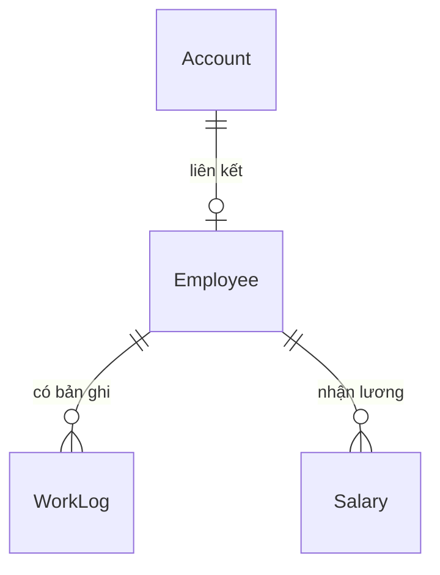

# ĐẶC TẢ DỰ ÁN VÀ KẾ HOẠCH TRIỂN KHAI

> **Đề tài:** Ứng dụng quản lý thời gian làm việc và tiền lương nhân viên  
> **Nền tảng:** Android, Java, XML, Room (SQLite), SharedPreferences, GitHub  
> **Nhóm thực hiện:** 5 thành viên  
> **Phiên bản tài liệu:** 1.0 — ngày 24/10/2026  
> **Trạng thái:** Tài liệu chỉ đạo triển khai; các quyết định trong tài liệu được xem là mặc định đã chốt.

---

## 0. CHỈ THỊ BẮT BUỘC DÀNH CHO MỌI THÀNH VIÊN VÀ TÁC NHÂN LẬP TRÌNH

**Đây là tài liệu đặc tả nguồn duy nhất của dự án.** Khi được giao phát triển ứng dụng, phải đọc toàn bộ tệp `docs/DAC_TA_DU_AN.md` trước khi sửa mã. Tài liệu mô tả yêu cầu, dữ liệu, hành vi, giao diện, phân quyền, hợp đồng giữa các module, phân công, cách kiểm thử và tiêu chí nghiệm thu.

### 0.1. Quy định NGÔN NGỮ — ƯU TIÊN CAO NHẤT

1. **100% nội dung giao tiếp và nội dung do con người đọc phải dùng tiếng Việt chuẩn, có dấu**, bao gồm: giao diện, nút bấm, nhãn, cảnh báo, lỗi, thông báo xác nhận, nội dung rỗng, nội dung mô tả, ghi chú, hướng dẫn, README, tài liệu, bình luận mã nguồn, mô tả bài kiểm thử, tiêu đề và mô tả yêu cầu hợp nhất mã, ghi chú phát hành, mô tả vấn đề trên GitHub, và **mọi thông điệp commit**.
2. **Thông điệp commit phải ngắn, súc tích, cụ thể, có ý nghĩa, bằng tiếng Việt có dấu.** Ưu tiên một hành động + một đối tượng; khoảng 4–12 từ. Không dùng các thông điệp chung chung hoặc tiếng Anh như `update`, `fix bug`, `initial commit`, `done`, `WIP`, `test`, `feat: add login`.
3. Ngoại lệ duy nhất đối với quy tắc ngôn ngữ là **định danh kỹ thuật không thể/không nên dịch**: Java, Android, API, SQL, XML, Gradle, Git/GitHub, Room, SharedPreferences, tên bảng/cột/Entity/Activity/DAO, tên phương thức, từ khóa mã nguồn, đường dẫn và tên tệp theo quy ước công cụ, tên thư viện, lệnh terminal, trạng thái lưu trong cơ sở dữ liệu (`ADMIN`, `EMPLOYEE`, `OPEN`, `COMPLETED`, `DRAFT`, `PAID`). Nội dung hiển thị cho người dùng phải chuyển các trạng thái này thành tiếng Việt.
4. Tên nhánh và tên tệp có thể dùng **tiếng Việt không dấu** để tương thích công cụ, ví dụ `tinh-nang/cham-cong`; **không** áp dụng quy tắc không dấu cho commit, README, bình luận hoặc giao diện.
5. Không tạo một bản README tiếng Anh hoặc tài liệu song ngữ. Nếu một gói phần mềm tạo văn bản mẫu bằng tiếng Anh, phải đổi phần mô tả phù hợp sang tiếng Việt trước khi hoàn thành công việc.
6. Khi tạo code, dùng định danh lập trình thống nhất như trong tài liệu và quy tắc Java; **không tự ý dịch** `Account` thành tên bảng khác vì đề bài đã cố định các bảng và thuộc tính.

### 0.2. Quy tắc thực thi

- **Ưu tiên chức năng đúng và hoàn thành nhanh hơn mở rộng tính năng.** Chỉ triển khai phạm vi P0 trước; P1/P2 không được gây chậm nghiệm thu.
- **Chính xác 4 bảng nghiệp vụ:** `Account`, `Employee`, `WorkLog`, `Salary`. Không tự tạo thêm bảng nghiệp vụ; lớp DTO, lớp kết quả truy vấn và lớp hỗ trợ không phải bảng. Room có thể tự tạo bảng metadata nội bộ như `room_master_table`; bảng kỹ thuật đó không được tính là bảng nghiệp vụ của đề.
- Không tự thay đổi cấu trúc bảng, trạng thái hoặc công thức lương. Nếu có yêu cầu thay đổi, trước tiên cập nhật tài liệu này và thông báo cho các module bị ảnh hưởng.
- Không để Activity thực thi SQL trực tiếp hoặc chứa thuật toán tính công, lương. Dùng lớp dịch vụ và DAO.
- Mọi thao tác dữ liệu chạy ngoài luồng giao diện; không dùng `allowMainThreadQueries()`.
- Không thêm backend, Firebase, mạng, đăng ký công khai, GPS, xác nhận sinh trắc học, đa ca/ngày hoặc xuất bảng tính vào phạm vi chính.
- Không báo hoàn thành khi chưa biên dịch và kiểm thử được. Nêu rõ nếu chưa có môi trường build hoặc chưa chạy được kiểm thử; **không giả lập kết quả kiểm thử**.
- Khi dùng tác nhân lập trình tự động, ưu tiên thay đổi nhỏ, có thể kiểm chứng; mỗi lần xử lý một nhóm task rõ ràng, không viết lại dự án nếu chưa cần thiết.
- Chỉ duy trì **một tệp Markdown đặc tả này trong thư mục `docs/`**. `README.md` tại thư mục gốc vẫn phải có, viết hoàn toàn bằng tiếng Việt theo Mục 17.

---

## 1. MỤC TIÊU, ĐẦU RA VÀ PHẠM VI

### 1.1. Mục tiêu môn học

Xây dựng ứng dụng Android ngoại tuyến giúp quản trị viên quản lý nhân viên và bảng lương; nhân viên tự chấm công, xem lịch sử làm việc và tiền lương. Ứng dụng phải chứng minh:

- Đăng nhập và phân quyền **Admin / Employee**.
- Lưu thông tin phiên/tài khoản đang đăng nhập bằng **SharedPreferences**.
- Lưu các bảng bắt buộc bằng **SQLite thông qua Room**.
- Admin thêm, sửa, xóa hợp lệ, tìm kiếm, xem nhân viên và mức lương theo giờ.
- Employee check-in/check-out, xem lịch sử và thống kê công tháng.
- Hệ thống tự tính giờ làm, giờ tăng ca và lương theo tháng.
- Admin quản lý bản ghi lương, Employee xem thông tin lương của chính mình.
- Chặn dữ liệu chấm công không hợp lệ, chấm công trùng và bản ghi thiếu giờ ra.
- Có lịch sử làm việc nhóm minh bạch trên GitHub; tối ưu thời gian hoàn thành.

### 1.2. Đầu ra bắt buộc

1. Dự án Android Studio build và chạy được bằng Java + XML.
2. Cơ sở dữ liệu Room có **đúng bốn bảng nghiệp vụ và đúng tên thuộc tính theo đề**.
3. Các màn hình và thao tác P0 chạy được từ đầu đến cuối.
4. `README.md` ở gốc, hướng dẫn sử dụng bằng tiếng Việt.
5. `docs/DAC_TA_DU_AN.md` (tệp này), không chia nhỏ tài liệu đặc tả thành nhiều Markdown khác.
6. Kiểm thử đơn vị phần tính giờ/lương, kiểm thử database và danh sách kịch bản nghiệm thu.
7. Lịch sử commit, nhánh, yêu cầu hợp nhất mã của cả 5 thành viên; commit tiếng Việt rõ nghĩa.
8. APK debug có thể tạo từ mã nguồn. Không cần xuất APK vào Git nếu repository đã chứa đủ mã để tái tạo.

### 1.3. Giới hạn phạm vi — quyết định cố định

- Một thiết bị hoặc một bộ giả lập Android dùng chung dữ liệu cục bộ; **không có đồng bộ giữa nhiều điện thoại**.
- Một nhân viên chỉ có **tối đa một phiên chấm công trong một ngày**, ca không qua nửa đêm.
- Không tính nghỉ trưa; không xét ngày lễ, cuối tuần hoặc lương theo hợp đồng.
- Tăng ca theo quy tắc mô phỏng: làm trên 8 giờ/ngày thì phần vượt tính hệ số **1,5**.
- Đơn vị tiền tệ: **VND**, dùng số nguyên đồng khi lưu lương.
- Không sửa chấm công đã hoàn tất trong MVP; không thay đổi giờ chấm công thủ công qua UI.
- `PAID` biểu thị Admin đánh dấu đã thanh toán; **không tích hợp giao dịch chuyển tiền**.
- Không xóa các bản ghi lịch sử chấm công/bảng lương đã phát sinh.

### 1.4. Thứ tự ưu tiên

- **P0 — bắt buộc:** đúng 4 bảng, login/role, SharedPreferences, CRUD/tìm kiếm nhân viên, chấm công, tính công/OT/lương, lịch sử cá nhân, quản lý lương, validation, GitHub.
- **P1 — sau P0:** dashboard tóm tắt, bố cục đẹp, lọc tiện dụng, kiểm thử tự động mở rộng.
- **P2 — ngoài phạm vi:** GPS, lịch ca phức tạp, xuất PDF/Excel, gửi thông báo, đồng bộ nhiều thiết bị, REST API, biểu đồ phức tạp.

---

## 2. CÔNG NGHỆ VÀ KIẾN TRÚC

| Thành phần | Quyết định | Lý do |
|---|---|---|
| Ngôn ngữ | Java | Khớp cấu trúc mẫu đề bài; 5 thành viên dễ phân chia |
| Giao diện | Android Views + XML Layout | Đủ yêu cầu và nhanh triển khai |
| IDE | Android Studio | Công cụ chuẩn để build, chạy giả lập, kiểm tra Room |
| SDK tối thiểu | `minSdk 26` | Sử dụng `java.time` trực tiếp; không cần hỗ trợ Android quá cũ |
| SDK biên dịch/đích | Dùng cấu hình Android Studio tương thích được cài thực tế | Không tự chốt phiên bản không có trong môi trường |
| CSDL | Room `2.8.5`, nền SQLite | Kiểm tra SQL khi build, dễ chia Entity/DAO |
| Xử lý annotation | `annotationProcessor` | Room hỗ trợ dự án Java thuần |
| Phiên đăng nhập | SharedPreferences `MODE_PRIVATE` | Đúng yêu cầu bài |
| Xử lý bất đồng bộ | `ExecutorService` | Không truy vấn Room trên luồng chính |
| Phân tầng | Activity → Service → DAO → Room | Nghiệp vụ không dính UI, dễ kiểm thử |
| Danh sách | RecyclerView | Hiển thị nhân viên, lịch sử, bảng lương |
| Kiểm soát phiên bản | GitHub + Pull Request | Phân công/kiểm tra, tránh sửa trùng |

**Cấu hình Room (Groovy `app/build.gradle`):**

```groovy
dependencies {
    implementation "androidx.room:room-runtime:2.8.5"
    annotationProcessor "androidx.room:room-compiler:2.8.5"
}
```

Sử dụng các dependency AndroidX cần thiết cho Views/RecyclerView/JUnit theo template và phiên bản tương thích thực tế của Android Studio. Chốt và commit `gradle-wrapper.properties`, build script, các phiên bản dependency trước khi chia nhánh. **Không trộn Room 3 hoặc mẫu Kotlin/KSP vào Java thuần.**

### 2.1. Luồng xử lý kiến trúc

```text
Người dùng
   ↓
Activity + XML (hiển thị, nhận thao tác)
   ↓
Service (xác thực quyền, kiểm tra dữ liệu, nghiệp vụ)
   ↓
DAO (truy vấn/ghi dữ liệu)
   ↓
Room Database (4 bảng)
```

- Activity không trực tiếp nắm thông tin mật khẩu, tính toán lương hoặc triển khai luật phân quyền.
- Service có thể phụ thuộc nhiều DAO để xử lý các tác vụ liên bảng.
- Với thao tác đa bước cần nhất quán, dùng `AppDB.runInTransaction(...)` hoặc `@Transaction` phù hợp trên background thread.
- Dùng một `AppDB` singleton cho toàn ứng dụng; version ban đầu `1`; không dùng `fallbackToDestructiveMigration()` để vô tình xóa dữ liệu khi thay schema.
- Chỉ dành DTO cho báo cáo/giao diện; không thêm Entity báo cáo vào AppDB.

---

## 3. ĐẶC TẢ CƠ SỞ DỮ LIỆU CHÍNH XÁC

### 3.1. Bốn bảng bắt buộc

Giữ **đúng tên bảng và thuộc tính** như đề bài, viết hoa/thường nhất quán với khai báo `@Entity(tableName = "...")` và `@ColumnInfo(name = "...")` khi cần:

```text
Account(id, username, password, role)
Employee(id, code, fullname, email, phone, hourlyRate, accountId)
WorkLog(id, employeeId, workDate, checkInTime, checkOutTime, totalHours, status)
Salary(id, employeeId, month, year, totalHours, overtimeHours, totalSalary, status)
```

| Bảng | Cột | Kiểu Java / SQLite | Ràng buộc, diễn giải |
|---|---|---|---|
| Account | `id` | `long` / INTEGER | PK, tự tăng |
| Account | `username` | `String` / TEXT | Bắt buộc, UNIQUE, không trống |
| Account | `password` | `String` / TEXT | Chuỗi **hash có salt**, không lưu mật khẩu rõ |
| Account | `role` | `String` / TEXT | Chỉ `ADMIN` hoặc `EMPLOYEE` |
| Employee | `id` | `long` / INTEGER | PK, tự tăng |
| Employee | `code` | `String` / TEXT | Bắt buộc, UNIQUE; ví dụ `NV001` |
| Employee | `fullname` | `String` / TEXT | Họ và tên, không để trống |
| Employee | `email` | `String` / TEXT | Email hợp lệ, UNIQUE sau chuẩn hóa |
| Employee | `phone` | `String` / TEXT | Số điện thoại hợp lệ theo quy tắc tại Mục 7 |
| Employee | `hourlyRate` | `long` / INTEGER | VND/giờ, số nguyên > 0 |
| Employee | `accountId` | `long` / INTEGER | FK → `Account.id`, NOT NULL, UNIQUE |
| WorkLog | `id` | `long` / INTEGER | PK, tự tăng |
| WorkLog | `employeeId` | `long` / INTEGER | FK → `Employee.id`, NOT NULL |
| WorkLog | `workDate` | `String` / TEXT | `yyyy-MM-dd`, ngày tại múi giờ Việt Nam |
| WorkLog | `checkInTime` | `String` / TEXT | `HH:mm:ss`, không null |
| WorkLog | `checkOutTime` | `String` / TEXT | Null nếu chưa check-out |
| WorkLog | `totalHours` | `double` / REAL | Giờ làm, từ số phút / 60; OPEN = 0 |
| WorkLog | `status` | `String` / TEXT | `OPEN` hoặc `COMPLETED` |
| Salary | `id` | `long` / INTEGER | PK, tự tăng |
| Salary | `employeeId` | `long` / INTEGER | FK → `Employee.id`, NOT NULL |
| Salary | `month` | `int` / INTEGER | 1–12 |
| Salary | `year` | `int` / INTEGER | Năm dương lịch |
| Salary | `totalHours` | `double` / REAL | Tổng giờ kể cả tăng ca |
| Salary | `overtimeHours` | `double` / REAL | Số giờ tăng ca đã nằm trong `totalHours` |
| Salary | `totalSalary` | `long` / INTEGER | Tổng tiền VND đã tính, làm tròn tới đồng |
| Salary | `status` | `String` / TEXT | `DRAFT` hoặc `PAID` |

### 3.2. Khóa, chỉ mục và quan hệ

| Bảng | Chỉ mục/khóa | Hành vi |
|---|---|---|
| Account | UNIQUE(`username`) | Không cho trùng tài khoản |
| Employee | UNIQUE(`code`) | Không cho trùng mã nhân viên |
| Employee | UNIQUE(`email`) | Không cho trùng email đã chuẩn hóa |
| Employee | UNIQUE(`accountId`) | Mỗi tài khoản liên kết tối đa một nhân viên |
| WorkLog | UNIQUE(`employeeId`, `workDate`) | Một bản ghi chấm công/người/ngày |
| Salary | UNIQUE(`employeeId`, `month`, `year`) | Một bảng lương/người/tháng |
| Employee → Account | FK, `onDelete = RESTRICT` | Không xóa Account khi còn Employee |
| WorkLog → Employee | FK, `onDelete = RESTRICT` | Không mất lịch sử công |
| Salary → Employee | FK, `onDelete = RESTRICT` | Không mất lịch sử lương |

Ngoài unique index, tạo index cho các khóa ngoại hoặc xác nhận index tổng hợp đã có tiền tố thích hợp, tránh cảnh báo Room. Validation ở Service hỗ trợ thông báo rõ ràng; **unique index/FK ở database là lớp bảo vệ cuối cùng**, không chỉ dựa vào kiểm tra trên UI.

### 3.3. Quan hệ và đồ thị



- Admin có `Account` với `role=ADMIN` và **không cần** Employee.
- Employee bắt buộc có Account `role=EMPLOYEE`; không cho sửa vai trò của Account này thành ADMIN bằng form nhân viên.
- Cả thao tác tạo Account + Employee và thao tác xóa Employee + Account hợp lệ đều phải nằm trong transaction.
- Nếu Employee có WorkLog hoặc Salary, nút Xóa từ chối và giải thích bằng tiếng Việt. Không triển khai xóa dây chuyền lịch sử.

### 3.4. Dữ liệu ngày giờ, định dạng, thời điểm

- Múi giờ nghiệp vụ cố định `Asia/Ho_Chi_Minh`, **không** phụ thuộc vào múi giờ tùy ý của điện thoại.
- Dùng `LocalDate`, `LocalTime`, `Duration` hoặc `LocalDateTime` từ `java.time` với `Clock` có thể tiêm vào để kiểm thử.
- Lưu ngày ở dạng `yyyy-MM-dd`, giờ ở dạng `HH:mm:ss`, luôn chuẩn hóa 2 chữ số.
- Giờ check-out bắt buộc **cùng workDate**, muộn hơn giờ check-in; không cho ca qua nửa đêm.
- Khi check-in, nếu còn **bất kỳ** WorkLog `OPEN` của nhân viên từ ngày trước, từ chối check-in mới và thông báo cần xử lý bản ghi dang dở. Do MVP không có chức năng sửa thủ công, bản ghi lỗi này cần reset dữ liệu demo hoặc quy trình hỗ trợ riêng ngoài phạm vi; không cho tự động xóa bản ghi.
- Nếu tháng đã có Salary `PAID`, không được ghi mới hoặc sửa WorkLog trong tháng đó.
- Không dùng thời gian do người dùng nhập ở màn hình chấm công; lấy đồng hồ hệ thống trong lớp Service để sử dụng nhất quán.

### 3.5. Quy tắc chuyển trạng thái

```text
WorkLog:
  chưa có → OPEN (check-in thành công)
  OPEN → COMPLETED (check-out hợp lệ)
  COMPLETED → không sửa / không check-out lại

Salary:
  chưa có → DRAFT (tính lương)
  DRAFT → DRAFT (tính lại, cập nhật cùng bản ghi)
  DRAFT → PAID (Admin xác nhận; chỉ cho tháng đã kết thúc)
  PAID → không tính lại / không chỉnh công trong tháng
```

**Không hỗ trợ** chuyển `PAID` ngược về `DRAFT` trong phiên bản thực hành.

---

## 4. PHÂN QUYỀN VÀ ĐĂNG NHẬP

| Chức năng | ADMIN | EMPLOYEE |
|---|---|---|
| Đăng nhập / đăng xuất | Có | Có |
| Xem, tìm kiếm danh sách nhân viên | Có | Không |
| Thêm, sửa, xóa nhân viên | Có | Không |
| Xem thông tin cá nhân và mức lương của mình | Không bắt buộc | Có |
| Check-in / check-out | Không | Có |
| Xem lịch sử, tổng giờ của nhân viên | Có thể xem qua báo cáo | Chỉ bản thân |
| Xem toàn bộ bảng lương | Có | Không |
| Tính/tính lại lương DRAFT | Có | Không |
| Đánh dấu lương PAID | Có | Không |
| Xem bảng lương bản thân | Không bắt buộc | Có |
| Xem thống kê toàn công ty | Có | Không |

### 4.1. Quy trình đăng nhập

1. Nhập username/password trên màn hình **Đăng nhập**; báo lỗi tiếng Việt khi trống.
2. Chuẩn hóa username (trim, quy ước không phân biệt hoa/thường **bằng cách lưu toàn bộ chữ thường**).
3. Đọc Account theo username từ Room trên luồng nền; xác minh password bằng hàm kiểm tra hash, tuyệt đối không so sánh plaintext lưu trong DB.
4. Khi thành công, lưu thông tin phiên vào SharedPreferences: `accountId`, `username`, `role`. Có thể lưu cờ `daDangNhap`, nhưng **ID phải được xác minh lại từ Room** khi khôi phục phiên.
5. Điều hướng role ADMIN đến **Tổng quan quản trị**, EMPLOYEE đến **Trang nhân viên**.
6. Khi app mở lại: đọc SharedPreferences, tìm lại Account trong Room, xác nhận role hợp lệ; nếu không khớp thì xóa phiên và quay về Đăng nhập.
7. Khi đăng xuất: xóa toàn bộ phiên, xóa back stack để không dùng nút Back quay vào màn hình cũ.

### 4.2. Mật khẩu và tính an toàn

- Cột `Account.password` **phải chứa giá trị băm chậm có salt riêng**, không chứa mật khẩu rõ. Đề xuất `PBKDF2WithHmacSHA256` kèm `SecureRandom` và chuỗi mã hóa có thông tin thuật toán/số vòng/salt/hash. Theo khuyến nghị OWASP, tham chiếu mức **600.000 vòng** cho PBKDF2-HMAC-SHA256; đánh giá hiệu năng trên emulator và chạy phép kiểm tra ngoài luồng chính.
- Không dùng MD5 hoặc SHA-256 đơn thuần để lưu password.
- Không lưu mật khẩu thô trong SharedPreferences, Git, commit, logcat hoặc báo lỗi.
- Tài khoản seed chỉ phục vụ demo offline, phải ghi chú rõ không phù hợp triển khai thực tế.
- Vì dữ liệu và session đều cục bộ, đây là **mô hình phân quyền ứng dụng demo**, không thay thế bảo mật có backend/chứng thực máy chủ.

---

## 5. NGHIỆP VỤ CHẤM CÔNG

### 5.1. Check-in

**Điều kiện:** tài khoản role EMPLOYEE, xác định được Employee từ Account phiên, không có bản ghi OPEN tồn đọng, chưa có WorkLog của ngày hiện tại, tháng hiện tại chưa bị chốt PAID.

**Thao tác:**

1. Nhận giờ hiện tại từ `Clock` và múi giờ đã chốt.
2. Kiểm tra điều kiện nghiệp vụ trên background thread.
3. Tạo WorkLog: `employeeId`, `workDate`, `checkInTime`, `checkOutTime=null`, `totalHours=0`, `status=OPEN`.
4. Chèn trong transaction; unique index vẫn phải chặn trường hợp thao tác đồng thời.
5. Hiển thị **“Chấm công vào thành công lúc HH:mm”**, vô hiệu hóa nút check-in và bật check-out.

### 5.2. Check-out

**Điều kiện:** tồn tại chính xác một WorkLog OPEN của ngày hiện tại, chưa có giờ ra, giờ ra > giờ vào, cùng ngày, tháng chưa bị chốt PAID.

**Thao tác:**

1. Lấy giờ hiện tại.
2. Tính `totalMinutes = Duration.between(checkIn, checkOut).toMinutes()`; vì thời gian có giây, **làm tròn xuống phút hoàn chỉnh**. Chặn nếu `totalMinutes <= 0`.
3. `totalHours = totalMinutes / 60.0` (lưu đủ độ chính xác double; chỉ làm tròn khi hiển thị).
4. Cập nhật cùng bản ghi: giờ ra, tổng giờ, trạng thái COMPLETED.
5. Hiển thị **“Chấm công ra thành công”** và số giờ làm của ngày.

### 5.3. Bản ghi chưa hoàn tất

- OPEN là trạng thái hợp lệ trong lúc nhân viên đang làm, **không được tính vào tổng giờ trả lương**.
- Employee xem lịch sử vẫn thấy OPEN với nhãn **“Đang làm việc”** và giờ ra là **“Chưa chấm công ra”**.
- Nếu cần tạo/chốt lương của một tháng còn OPEN, phải từ chối và hiển thị **“Tháng này còn lượt chấm công chưa hoàn tất”**. Không được âm thầm bỏ qua để đánh dấu PAID.
- Tình huống quên check-out qua ngày **không có luồng sửa trong MVP**; thể hiện giới hạn này trong README. Nếu giảng viên yêu cầu xử lý, phải bổ sung quyết định nghiệp vụ trước khi sửa code.

---

## 6. NGHIỆP VỤ TÍNH CÔNG, TĂNG CA VÀ LƯƠNG

### 6.1. Các hằng số nghiệp vụ

```text
PHUT_GIO_CHUAN_MOI_NGAY = 480
HE_SO_TANG_CA = 1.5
DON_VI_TIEN = VND
MUI_GIO = Asia/Ho_Chi_Minh
```

Tất cả đặt trong một lớp `Constants`/`PayrollPolicy` dùng chung; không nhập hệ số tăng ca thủ công từ UI. Đây là **quy tắc giả định phục vụ bài thực hành**, không mô phỏng đầy đủ pháp luật lao động Việt Nam.

### 6.2. Công thức đúng

Tính trên **từng ngày COMPLETED**, không lấy tổng giờ tháng trừ một ngưỡng cố định.

```text
phutLam = số phút giữa checkIn và checkOut (làm tròn xuống phút)
phutThuong = min(phutLam, 480)
phutTangCa = max(0, phutLam - 480)

TongPhutThang = tổng(phutLam)
TongPhutTangCaThang = tổng(phutTangCa)
TongPhutThuongThang = TongPhutThang - TongPhutTangCaThang

LuongChuaLamTron = ((TongPhutThuongThang * hourlyRate)
                  + (TongPhutTangCaThang * hourlyRate * 1.5)) / 60

TongLuongVND = làm tròn HALF_UP LuongChuaLamTron tới đơn vị đồng
Salary.totalHours = TongPhutThang / 60.0
Salary.overtimeHours = TongPhutTangCaThang / 60.0
Salary.totalSalary = TongLuongVND
```

- `totalHours` **đã bao gồm** giờ tăng ca; không cộng `totalHours + overtimeHours`.
- **Không dùng `double` để tính tiền.** Dùng số phút nguyên (`long`) và `BigDecimal` cho phép nhân/chia/làm tròn; trường `totalHours` double chỉ phục vụ lưu/hiển thị đúng schema.
- **Không tính lương từ `WorkLog.totalHours` đã bị làm tròn khi hiển thị.** Tính từ số phút nguyên được suy ra từ giờ vào/ra.
- Nếu không có giờ công trong tháng: cho tạo DRAFT với 0 giờ/0 đồng, hiển thị rõ **“Chưa có công trong tháng”**.
- Dữ liệu đầu vào công/lương chưa hoàn tất phải làm cả phép tính **thất bại rõ ràng**, không tạo bản ghi hợp lệ giả.

### 6.3. Trình tự quản lý lương

1. Admin chọn tháng/năm và nhân viên (hoặc lần lượt nhân viên trong danh sách).
2. Service xác thực quyền ADMIN và hợp lệ tháng/năm.
3. Truy vấn WorkLog của tháng đó; từ chối nếu có OPEN.
4. Nếu Salary hiện tại là PAID: **không cập nhật**, trả lỗi tiếng Việt.
5. Tính giờ thường/OT và tổng lương bằng công thức thống nhất.
6. Nếu chưa có Salary thì INSERT DRAFT; nếu đã có DRAFT thì UPDATE **cùng ID** trong transaction. UNIQUE(`employeeId`,`month`,`year`) chống trùng.
7. Màn hình hiển thị tổng giờ, OT, tổng tiền, trạng thái.
8. Chỉ cho xác nhận **PAID** khi kỳ lương đã kết thúc (tháng/năm nhỏ hơn tháng hiện tại tại múi giờ Việt Nam), không còn OPEN; xác nhận thay đổi trạng thái sau khi Admin đồng ý.
9. Kỳ PAID là bất biến trong MVP; nhân viên chỉ được xem, không được sửa/xóa.

### 6.4. Ví dụ chuẩn bắt buộc đạt

Với nhân viên lương `50.000 VND/giờ`:

| Ngày công | Số ngày | Giờ mỗi ngày | Tổng giờ | Giờ OT |
|---|---:|---:|---:|---:|
| Ngày thường | 20 | 8 | 160 | 0 |
| Ngày làm dài | 2 | 10 | 20 | 4 |
| **Tổng** | **22** | | **180** | **4** |

```text
Giờ thường = 176
Lương thường = 176 × 50.000 = 8.800.000 VND
Lương OT = 4 × 50.000 × 1,5 = 300.000 VND
Tổng lương = 9.100.000 VND
```

Kết quả bắt buộc: `Salary.totalHours = 180`, `Salary.overtimeHours = 4`, `Salary.totalSalary = 9100000`.

### 6.5. Rủi ro thay đổi đơn giá

Schema không có bảng lịch sử đơn giá; do đó khi sửa `Employee.hourlyRate`, chỉ các bản ghi lương **DRAFT được tính lại sau thời điểm sửa** nhận đơn giá mới. Bảng lương PAID giữ nguyên `totalSalary` đã lưu. Trong MVP không đưa ra tuyên bố rằng hệ thống theo dõi lịch sử đơn giá chuẩn kế toán.

---

## 7. QUY TẮC VALIDATION VÀ THÔNG BÁO LỖI

| Dữ liệu/tình huống | Quy tắc | Thông báo tiếng Việt gợi ý |
|---|---|---|
| Tên tài khoản | Trim; lưu chữ thường; không trống; không trùng | “Tên đăng nhập đã tồn tại” |
| Mật khẩu đăng nhập | Không để trống; chỉ xác thực hash | “Tên đăng nhập hoặc mật khẩu không đúng” |
| Vai trò | Chỉ ADMIN/EMPLOYEE | “Tài khoản không có quyền truy cập” |
| Mã nhân viên | Trim, chuẩn hóa chữ hoa; không trống/trùng | “Mã nhân viên đã tồn tại” |
| Họ và tên | Trim; độ dài 2–100 ký tự | “Vui lòng nhập họ và tên hợp lệ” |
| Email | Trim, chữ thường; có dạng email; không trùng | “Email không hợp lệ hoặc đã được sử dụng” |
| Điện thoại | Chấp nhận số Việt Nam `0` + 9 chữ số; không chèn dấu cách | “Số điện thoại phải gồm 10 chữ số và bắt đầu bằng 0” |
| Đơn giá giờ | Số nguyên VND > 0, nằm trong miền an toàn của `long` | “Đơn giá giờ phải lớn hơn 0” |
| Check-in trùng ngày | UNIQUE và kiểm tra trước | “Bạn đã chấm công vào hôm nay” |
| Có phiên OPEN ngày trước | Không mở phiên mới | “Bạn có lượt chấm công chưa hoàn tất” |
| Check-out khi chưa check-in | Không cho | “Bạn chưa chấm công vào hôm nay” |
| Check-out lần thứ hai | Không cho | “Bạn đã chấm công ra hôm nay” |
| Check-out <= check-in | Không cho | “Giờ chấm công ra phải sau giờ vào” |
| Check-out sang ngày khác | Không cho trong MVP | “Ứng dụng chưa hỗ trợ ca làm qua ngày” |
| OPEN trong tháng tính lương | Không chốt/tạo lương | “Tháng này còn lượt chấm công chưa hoàn tất” |
| Tạo lại Salary DRAFT | Cập nhật, không thêm | “Đã cập nhật bảng lương tháng” |
| Tính lại Salary PAID | Không cho | “Bảng lương đã thanh toán, không thể tính lại” |
| Chốt lương tháng đang diễn ra | Không cho | “Chỉ có thể chốt lương của tháng đã kết thúc” |
| Xóa nhân viên có lịch sử | Không cho | “Không thể xóa nhân viên đã có dữ liệu công hoặc lương” |
| Truy cập dữ liệu khác người | Kiểm tra tại Service | “Bạn không có quyền xem thông tin này” |
| CSDL lỗi/vi phạm unique | Bắt ngoại lệ và thông báo phù hợp | “Không thể lưu dữ liệu. Vui lòng kiểm tra và thử lại” |

- Không để app văng vì input sai hoặc lỗi unique/FK; bắt lỗi đúng tầng và phản hồi rõ cho người dùng.
- Các quy tắc không thể diễn đạt bằng index (độ dài, trạng thái, số dương) phải được xác thực ở Service và khi nhập form; không phụ thuộc duy nhất vào form.
- Cùng một thông báo nghiệp vụ nên được định nghĩa tại `strings.xml` với tên resource không dấu.

---

## 8. MÀN HÌNH VÀ YÊU CẦU UI/UX

Mọi nhãn nhìn thấy trên UI **bằng tiếng Việt có dấu**. Dùng định dạng ngày `dd/MM/yyyy` khi hiển thị, giờ `HH:mm`, tiền `vi-VN` và hậu tố `đ`, số giờ tối đa hai chữ số thập phân; lưu dữ liệu theo dạng chuẩn Mục 3.

| Mã | Màn hình | Role | Thành phần / thao tác |
|---|---|---|---|
| UI-01 | Đăng nhập | Cả hai | Tên đăng nhập, mật khẩu, nút “Đăng nhập”, báo lỗi |
| UI-02 | Tổng quan quản trị | ADMIN | Số nhân viên, tổng công tháng, tổng lương tháng; điều hướng |
| UI-03 | Danh sách nhân viên | ADMIN | Tìm kiếm tên/mã/email; danh sách, mở chi tiết, thêm |
| UI-04 | Thêm/sửa nhân viên | ADMIN | Mã, họ tên, email, SĐT, đơn giá, tài khoản đăng nhập, lưu/hủy |
| UI-05 | Chi tiết nhân viên | ADMIN | Đủ thông tin, sửa, xóa có xác nhận, không hiển thị hash |
| UI-06 | Danh sách lương | ADMIN | Chọn tháng/năm, danh sách theo nhân viên, tạo/tính lại lương |
| UI-07 | Chi tiết lương | ADMIN | Giờ thường, OT, tổng giờ, tiền, trạng thái, chốt PAID |
| UI-08 | Trang nhân viên | EMPLOYEE | Lời chào, thông tin cá nhân, trạng thái công hôm nay, điều hướng |
| UI-09 | Chấm công | EMPLOYEE | Ngày, giờ hiện tại, giờ vào/ra, check-in/check-out đúng trạng thái |
| UI-10 | Lịch sử công và tổng kết tháng | EMPLOYEE | Lọc tháng, danh sách ngày, số giờ, giờ OT, tổng công |
| UI-11 | Lương của tôi | EMPLOYEE | Chọn tháng/năm, tổng giờ/OT/lương, trạng thái; chỉ của bản thân |

**Quy định giao diện:**

- Đơn giản, đồng nhất, dễ demo; không cần animation phức tạp.
- Mỗi màn hình có trạng thái: đang tải, không có dữ liệu, thành công và lỗi.
- Hiển thị hộp xác nhận trước khi xóa nhân viên hoặc chốt lương.
- Khi nút đang xử lý, vô hiệu hóa tạm để giảm thao tác lặp.
- Không cho Employee vào Activity Admin bằng đường điều hướng hoặc Intent thủ công; **kiểm tra role khi Activity bắt đầu và trong Service**.
- Không hiển thị password/hash, dữ liệu cá nhân người khác hoặc stack trace.
- `strings.xml` chứa toàn bộ câu chữ UI. Tên lớp/tệp Android vẫn tuân thủ quy ước kỹ thuật và bảng tên ở Mục 9.

---

## 9. CẤU TRÚC DỰ ÁN VÀ QUYỀN SỞ HỮU TỆP

Tổ chức project theo **một module Android `app`**, package mặc định `com.example.employeemanager` (nếu repository có application ID sẵn thì thống nhất trước, không đổi tùy tiện). Cấu trúc logic tương ứng với `app/src/main/java/...`:

```text
<thư mục gốc repository>/
├── README.md                             [TV1 khởi tạo, TV5 rà soát]
├── docs/
│   └── DAC_TA_DU_AN.md                   [Tài liệu duy nhất trong docs/]
├── app/
│   ├── src/main/
│   │   ├── AndroidManifest.xml            [TV1 điều phối]
│   │   ├── java/com/example/employeemanager/
│   │   │   ├── MainActivity.java          [TV1]
│   │   │   ├── data/
│   │   │   │   ├── AppDB.java             [TV1]
│   │   │   │   ├── entities/
│   │   │   │   │   ├── Account.java       [TV1]
│   │   │   │   │   ├── Employee.java      [TV2]
│   │   │   │   │   ├── WorkLog.java       [TV3]
│   │   │   │   │   └── Salary.java        [TV4]
│   │   │   │   ├── dao/
│   │   │   │   │   ├── AccountDao.java    [TV1]
│   │   │   │   │   ├── EmployeeDao.java   [TV2]
│   │   │   │   │   ├── WorkLogDao.java    [TV3]
│   │   │   │   │   ├── SalaryDao.java     [TV4]
│   │   │   │   │   └── ReportDao.java     [TV5]
│   │   │   │   └── dto/
│   │   │   │       ├── MonthlySummary.java [TV5]
│   │   │   │       └── SalaryBreakdown.java [TV4]
│   │   │   ├── auth/
│   │   │   │   ├── LoginActivity.java     [TV1]
│   │   │   │   ├── AuthService.java       [TV1]
│   │   │   │   ├── SessionManager.java    [TV1]
│   │   │   │   └── PasswordHasher.java    [TV1]
│   │   │   ├── employee/
│   │   │   │   ├── EmployeeListActivity.java [TV2]
│   │   │   │   ├── EmployeeFormActivity.java [TV2]
│   │   │   │   ├── EmployeeDetailActivity.java [TV2]
│   │   │   │   └── EmployeeService.java   [TV2]
│   │   │   ├── attendance/
│   │   │   │   ├── AttendanceActivity.java [TV3]
│   │   │   │   ├── WorkHistoryActivity.java [TV3]
│   │   │   │   ├── AttendanceService.java [TV3]
│   │   │   │   └── WorkHourCalculator.java [TV3]
│   │   │   ├── salary/
│   │   │   │   ├── SalaryListActivity.java [TV4]
│   │   │   │   ├── SalaryDetailActivity.java [TV4]
│   │   │   │   ├── SalaryService.java    [TV4]
│   │   │   │   └── SalaryCalculator.java [TV4]
│   │   │   ├── reports/
│   │   │   │   ├── AdminDashboardActivity.java [TV5]
│   │   │   │   ├── MonthlySummaryActivity.java [TV5]
│   │   │   │   ├── MySalaryActivity.java [TV5]
│   │   │   │   └── ReportService.java    [TV5]
│   │   │   └── util/
│   │   │       ├── Constants.java        [TV1]
│   │   │       └── DateTimeUtils.java    [TV3]
│   │   └── res/
│   │       ├── layout/                    [Theo chủ màn hình]
│   │       └── values/strings.xml        [Theo prefix mỗi module]
│   ├── src/test/                         [Mỗi người test module mình]
│   └── src/androidTest/                  [Kiểm thử Room / tích hợp khi có môi trường]
├── gradle/
└── <các tệp cấu hình Gradle chuẩn>
```

**Không bắt buộc tạo tất cả file trống trước.** Chỉ tạo file khi có chức năng cần thiết. Nếu cần adapter RecyclerView, lớp yêu cầu tạo nhân viên hoặc DTO khác, đặt trong package của module sở hữu và ghi lại hợp đồng công khai ở Mục 10 khi thay đổi API liên module.

### 9.1. Tệp dễ xung đột — quy tắc sở hữu

| Tệp | Quy tắc |
|---|---|
| `AppDB.java` | TV1 sở hữu; công bố ngay chữ ký trả về của 5 DAO; thay đổi qua PR |
| `AndroidManifest.xml` | TV1 điều phối khai báo Activity; người khác không chỉnh đồng thời |
| `build.gradle` và Gradle Wrapper | TV1 khóa phiên bản; thêm dependency phải thống nhất |
| `Constants.java` | TV1 giữ role/status/OT; TV3/TV4 tham chiếu, không tạo bản sao |
| `strings.xml` | Mỗi module đặt prefix riêng: `auth_`, `nv_`, `cong_`, `luong_`, `bc_` |
| `themes.xml`, `colors.xml` | TV1 khởi tạo, nhóm dùng chung; không chỉnh tùy tiện |
| `README.md` | TV1 tạo sườn, TV5 cập nhật demo và kiểm tra tiếng Việt |
| `docs/DAC_TA_DU_AN.md` | Chỉ sửa khi thay đổi đặc tả có sự đồng thuận |

---

## 10. HỢP ĐỒNG GIAO TIẾP GIỮA CÁC MODULE

Mục này quyết định cách 5 người code độc lập. **Định danh API dưới đây là hợp đồng tối thiểu; được phép thêm hàm phụ nội bộ nhưng không đổi tên, kiểu hoặc ý nghĩa API công khai mà không thống nhất.** Các hàm thao tác Room được gọi ở background thread bởi lớp điều phối dùng `ExecutorService`; chữ ký bên dưới mô tả xử lý đồng bộ **trên worker**, không cho gọi trực tiếp từ luồng giao diện.

### 10.1. Module Authentication — TV1

```java
AuthResult login(String username, String plainPassword);
void logout();
SessionData getValidatedSession();
long requireCurrentEmployeeId();
void requireRole(String requiredRole);
```

- `AuthResult` trả về thành công/thất bại, `accountId` và `role`; không lộ hash.
- `SessionData` được xác thực lại từ Account, không tin role chỉ nằm trong preferences.
- `requireCurrentEmployeeId()` tự tra Account → Employee; **không nhận `employeeId` từ màn hình của Employee**.
- Đổi role hoặc xóa tài khoản trong DB thì phiên hiện tại phải bị đánh giá lại/đăng xuất.

### 10.2. Module Employee — TV2

```java
Employee createEmployee(CreateEmployeeRequest request);
Employee updateEmployee(long employeeId, UpdateEmployeeRequest request);
void deleteEmployee(long employeeId);
List<Employee> searchEmployees(String keyword);
Employee getEmployeeById(long employeeId);
Employee getEmployeeByAccountId(long accountId);
```

- `CreateEmployeeRequest` chứa đủ thông tin Employee cùng `username` và mật khẩu ban đầu của Account EMPLOYEE.
- Tạo Account và Employee trong một transaction; lỗi giữa chừng phải rollback toàn bộ.
- Sửa nhân viên không được tự thay role. Không cần chức năng đổi password trong MVP.
- Xóa chỉ thành công khi Employee chưa có WorkLog/Salary, rồi xóa Account liên kết trong transaction.
- `searchEmployees` tìm gần đúng theo mã, họ tên, email, không phân biệt hoa thường; kết quả sắp tên/mã ổn định.

### 10.3. Module Attendance — TV3

```java
WorkLog checkIn();
WorkLog checkOut();
WorkLog getTodayWorkLog();
List<WorkLog> getAttendanceHistory(int month, int year);
List<WorkLog> getCompletedLogsByMonth(long employeeId, int month, int year);
long calculateWorkMinutes(LocalTime start, LocalTime end);
```

- Check-in/check-out bắt buộc suy ra employeeId từ session đã xác thực.
- `getAttendanceHistory` của Employee không nhận ID tùy ý từ UI. Hàm truy vấn dùng trong nội bộ payroll mới nhận `employeeId` và chỉ cho Service được phân quyền truy cập.
- `calculateWorkMinutes` là hàm thuần, kiểm thử được với thời gian cố định.
- Dùng `Clock` có thể cấu hình để unit test check-in/check-out mà không phải chờ theo thời gian thực.

### 10.4. Module Salary — TV4

```java
Salary generateMonthlySalary(long employeeId, int month, int year);
Salary getSalaryByMonth(long employeeId, int month, int year);
List<Salary> getSalariesByMonth(int month, int year);
Salary confirmSalaryPaid(long salaryId);
SalaryBreakdown calculateSalaryBreakdown(List<WorkLog> logs, long hourlyRate);
```

- Tất cả tác vụ tạo/chốt/xem tất cả Salary bắt buộc role ADMIN, ngoại trừ `getSalaryByMonth` khi được gọi qua ReportService đã kiểm tra `employeeId` sở hữu. Tách rõ hàm truy vấn nội bộ khỏi API cấp quyền cho UI.
- `getSalaryByMonth` là truy vấn nội bộ: không gọi trực tiếp từ màn hình nhân viên. Khi nhân viên muốn xem lương, bắt buộc đi qua `ReportService.getMySalary()` để kiểm tra chủ sở hữu.
- `SalaryBreakdown` là DTO có tổng phút, phút thường, phút OT, số tiền; không phải Entity.
- `generateMonthlySalary` giao dịch đọc trạng thái + ghi mới/cập nhật; phải idempotent đối với bản ghi DRAFT.
- `confirmSalaryPaid` kiểm tra tháng đã kết thúc, không có OPEN, trả về bản ghi sau cập nhật; không xác nhận hai lần.

### 10.5. Module Reports — TV5

```java
MonthlySummary getMyMonthlySummary(int month, int year);
Salary getMySalary(int month, int year);
CompanySummary getAdminMonthlySummary(int month, int year);
```

- `getMy...` lấy `employeeId` từ session tại Service, không do client chọn.
- `CompanySummary` là DTO (không thêm bảng), trả về số nhân viên, tổng giờ tháng, tổng lương DRAFT/PAID theo đúng phạm vi được mô tả trên màn hình. Nếu hiển thị “Tổng lương đã thanh toán”, chỉ cộng PAID; nếu “Tổng lương đã tính”, cộng DRAFT + PAID và ghi rõ nhãn.
- Tổng giờ làm báo cáo lấy từ WorkLog COMPLETED để không phụ thuộc vào việc Admin đã tạo Salary hay chưa.
- Nếu Salary chưa tồn tại, giao diện hiển thị **“Chưa có bảng lương tháng này”**, không tự tạo Salary từ quyền Employee.

### 10.6. Hợp đồng lỗi và luồng UI

- Service trả về kết quả/ngoại lệ nghiệp vụ cụ thể; UI chuyển lỗi thành câu tiếng Việt ổn định.
- DAO không tự điều hướng Activity, không nắm Context UI.
- Truy vấn/ghi trên worker; thao tác cập nhật View/Toast/Dialog thực hiện trên main thread khi worker hoàn tất.
- Bảo đảm chống nhấn nút liên tục và không làm mất ngoại lệ database.
- Không cache bản sao riêng của dữ liệu Employee/Salary trong SharedPreferences.

---

## 11. BẢNG PHÂN CÔNG 5 NGƯỜI — 100 ĐIỂM CÔNG SỨC

**Đơn vị `điểm`:** ước lượng khối lượng tương đối, không phải điểm chấm của giảng viên. Mỗi thành viên **20/100 điểm (20%)**, đều phải tham gia viết tính năng và test. Với những việc có phụ thuộc, được phép dùng mock/seed để làm song song; không chờ người khác hoàn thành mới bắt đầu.

| Người | Mã task | Công việc / đầu ra nghiệm thu | Điểm | Phụ thuộc chính |
|---|---|---|---:|---|
| **TV1** | NEN-01 | Scaffold Android, Gradle, GitHub, package, AppDB và khung 4 Entity/DAO, chia API contract | 4 | Đặc tả đã chốt |
| TV1 | DN-01 | AccountDao, xác minh mật khẩu, AuthService, seed Admin | 5 | NEN-01 |
| TV1 | DN-02 | LoginActivity, báo lỗi, điều hướng đúng role | 4 | DN-01 |
| TV1 | DN-03 | SessionManager dùng SharedPreferences, khôi phục phiên, logout, kiểm tra quyền | 4 | DN-01 |
| TV1 | DN-04 | Test đăng nhập, session, quyền; điều phối Manifest/AppDB/merge nền | 3 | Các module có PR |
| | | **Tổng TV1** | **20** | |
| **TV2** | NV-01 | Employee Entity/Dao: truy vấn, index, tìm kiếm | 4 | NEN-01 |
| TV2 | NV-02 | EmployeeListActivity, RecyclerView, tìm theo mã/tên/email | 4 | NV-01 |
| TV2 | NV-03 | Form thêm/sửa nhân viên và validation | 5 | NV-01 |
| TV2 | NV-04 | Tạo Account EMPLOYEE kèm Employee trong transaction; xóa có kiểm tra lịch sử | 5 | API Auth TV1 |
| TV2 | NV-05 | Test CRUD/tìm kiếm/trùng mã-email/rollback | 2 | NV-01...04 |
| | | **Tổng TV2** | **20** | |
| **TV3** | CC-01 | WorkLog Entity/Dao, unique một ngày, query tháng | 4 | NEN-01 |
| TV3 | CC-02 | Check-in, trạng thái OPEN, chống trùng | 4 | CC-01, session |
| TV3 | CC-03 | Check-out, tính phút/giờ, trạng thái COMPLETED, kiểm tra thời gian | 5 | CC-02 |
| TV3 | CC-04 | AttendanceActivity, WorkHistoryActivity, lịch sử/filter/trạng thái | 4 | CC-01...03 |
| TV3 | CC-05 | Test lỗi chấm công, Clock cố định, dữ liệu OPEN | 3 | CC-02...04 |
| | | **Tổng TV3** | **20** | |
| **TV4** | LG-01 | SalaryCalculator: số phút thường, OT 1,5, BigDecimal | 5 | Chính sách Mục 6 |
| TV4 | LG-02 | Salary Entity/Dao, truy vấn WorkLog, tổng hợp tháng | 4 | CC-01 hoặc mock |
| TV4 | LG-03 | Tạo/tính lại DRAFT, chốt PAID, transaction/unique/khóa kỳ | 5 | LG-01...02 |
| TV4 | LG-04 | SalaryListActivity, SalaryDetailActivity của Admin | 3 | LG-03 hoặc mock |
| TV4 | LG-05 | Test phép tính, OT, 0 công, OPEN, lương trùng, kỳ PAID | 3 | LG-01...04 |
| | | **Tổng TV4** | **20** | |
| **TV5** | BC-01 | MonthlySummaryActivity, ReportDao, thống kê công tháng Employee | 5 | Hợp đồng WorkLog |
| TV5 | BC-02 | MySalaryActivity, quyền chỉ xem lương của mình | 4 | Hợp đồng Salary |
| TV5 | BC-03 | AdminDashboardActivity, tổng quan nhân viên/công/lương | 4 | DAO hoặc DTO mẫu |
| TV5 | KT-01 | Tạo và chạy kịch bản kiểm thử end-to-end, kiểm tra role/database | 5 | Luồng các module |
| TV5 | KT-02 | Rà soát README tiếng Việt, bằng chứng demo, checklist, tạo APK debug | 2 | Các module hoàn tất |
| | | **Tổng TV5** | **20** | |
| | | **TỔNG NHÓM** | **100** | |

### 11.1. Giới hạn trách nhiệm

- Mỗi người sở hữu code, UI và unit test thuộc module mình.
- TV1 **không gánh việc sửa mọi bug của nhóm**; TV1 điều phối AppDB, Manifest, cấu hình và khung chung.
- TV5 **không chịu toàn bộ việc kiểm thử thay bốn người kia**; TV5 đảm nhiệm báo cáo và luồng kiểm thử xuyên module.
- TV4 kiểm thử tính lương bằng data giả ngay khi bắt đầu; TV5 làm dashboard bằng DTO/mock trước khi tích hợp thật.
- Khi phát sinh lỗi liên module, xác định lớp gây lỗi: chủ lớp đó sửa, người phát hiện bổ sung ca kiểm thử.
- Điểm công sức là ước lượng; rà lại sau vòng đầu dựa trên đầu ra thực và chuyển một số ca test/bug nếu chênh lệch quá lớn.

### 11.2. Tiêu chí hoàn tất cho từng task

Một task được đánh dấu hoàn tất **chỉ khi**:

1. File/classes/layout cần thiết tồn tại, hoạt động theo đặc tả.
2. Phải có xử lý lỗi và validation liên quan.
3. Test của task đã chạy hoặc nêu rõ vì sao chưa chạy được.
4. Không làm hỏng chức năng đã hợp nhất vào `main`.
5. Có commit tiếng Việt và PR tiếng Việt (nếu làm việc theo nhánh).
6. Người tích hợp có thể gọi API đã công bố mà không phải đọc sâu mã nội bộ.

---

## 12. KẾ HOẠCH THỰC HIỆN SONG SONG VÀ MỐC GIAO NHẬN

### Giai đoạn 0 — Thống nhất (mục tiêu 0–1,5 giờ làm việc tập trung)

- Tất cả đọc đặc tả, xác nhận công thức OT, schema, role và ngoại lệ MVP.
- Chốt application ID, cấu hình Gradle, giao diện chung, cách chuyển Activity.
- Tạo bảng công việc GitHub Issues theo task Mục 11; giao đúng người.

### Giai đoạn 1 — Nền tảng chạy được (mục tiêu 1,5–3 giờ)

- TV1 khởi tạo project, build lần đầu, tạo AppDB 4 Entity/5 DAO giao diện tối thiểu, constants, session API, seed demo tối thiểu.
- Tạo 5 nhánh; mỗi thành viên kéo `main` đã có hợp đồng và bắt đầu file của mình.
- **Mốc bắt buộc:** mở app không crash, Room khởi tạo bốn bảng, có thể chạy build debug.

### Giai đoạn 2 — Lập trình song song (mục tiêu 3–9 giờ)

- TV1: login/session/auth.
- TV2: CRUD và form nhân viên.
- TV3: check-in/check-out/lịch sử.
- TV4: SalaryCalculator từ dữ liệu mẫu, sau đó Salary DAO/UI.
- TV5: báo cáo và dashboard từ dữ liệu giả, test case và UI lương cá nhân.
- Merge PR nhỏ, có chức năng hoàn chỉnh; không chờ cuối giai đoạn mới merge.

### Giai đoạn 3 — Tích hợp (mục tiêu 9–13 giờ)

- Kết nối Employee tạo Account, Employee login → Attendance, WorkLog → Salary, Salary → Reports.
- Xác nhận mọi Service kiểm tra role đúng.
- Chạy kiểm thử dữ liệu xuyên bảng và sửa lỗi với chủ module tương ứng.

### Giai đoạn 4 — Nghiệm thu (mục tiêu 13–16 giờ)

- Chạy tất cả P0 theo Mục 15, chuẩn bị dữ liệu tháng trước có OT.
- Rà soát tiếng Việt, README, commit/PR, giao diện, kiểm tra database qua App Inspection.
- Tạo APK debug, thử cài sạch, chạy lại kịch bản demo.

**Các mốc thời gian chỉ là ước lượng để tổ chức; không được tuyên bố đã đạt nếu chưa thực nghiệm.** Khi có lỗi build, ưu tiên sửa để giữ `main` luôn chạy được thay vì tiếp tục thêm UI phụ.

### 12.1. Phụ thuộc và cách gỡ nút thắt

```text
Chốt tài liệu + hợp đồng
       ↓
TV1: scaffold + 4 Entity + 5 DAO interfaces
       ├── TV2: Employee CRUD ─────────────┐
       ├── TV3: Attendance ────────────────┤
       ├── TV4: Salary (dữ liệu giả trước) ┤── Tích hợp → Test E2E → APK
       ├── TV5: Reports (mock trước) ─────┤
       └── TV1: Auth + session ────────────┘
```

- Khi Entity hoặc DAO chưa sẵn, dùng fake/in-memory object **chỉ trong test hoặc giao diện mock**, không giữ dữ liệu giả làm nguồn dữ liệu thật trong bản giao.
- Những thay đổi có thể khiến API không tương thích phải được thông báo trước trong PR.

---

## 13. QUY ƯỚC GIT, GITHUB VÀ COMMIT TIẾNG VIỆT

### 13.1. Nhánh

```text
main
├── tinh-nang/nen-tang-dang-nhap     (TV1)
├── tinh-nang/quan-ly-nhan-vien     (TV2)
├── tinh-nang/cham-cong            (TV3)
├── tinh-nang/tinh-luong           (TV4)
└── tinh-nang/bao-cao-kiem-thu     (TV5)
```

**Lưu ý:** Tên nhánh không dấu để tránh khó khăn khi gõ lệnh; ý nghĩa vẫn là tiếng Việt. Nếu tên nhánh cần giữ nguyên theo công cụ, dùng quy tắc nhất quán từ lúc tạo.

### 13.2. Cách làm việc

1. Mỗi người tạo branch từ `main` mới nhất; chỉ sửa khu vực sở hữu, trừ thay đổi API đã được duyệt.
2. Một commit chỉ chứa **một thay đổi logic có thể hiểu được**; commit nhỏ giúp review/revert dễ dàng.
3. Sau khi hoàn thiện một task/chức năng, push branch và tạo Pull Request vào `main`; tiêu đề và mô tả bằng tiếng Việt.
4. Tối thiểu một người khác review (nếu quyền và cấu hình repository cho phép); kiểm tra thay đổi, build và điều kiện nghiệm thu.
5. Cập nhật nhánh trước khi merge khi `main` đã đổi; giải quyết conflict bằng người sở hữu file.
6. Không commit `local.properties`, khóa bí mật, mật khẩu thực, thư mục `.gradle/`, `build/`, tệp tạm của IDE; sử dụng `.gitignore` Android chuẩn.
7. Nếu branch protection khả dụng, chặn force push/xóa `main`, yêu cầu PR và các kiểm tra build/test phù hợp.
8. Lịch sử Git phản ánh đúng đóng góp cá nhân; không nhờ một người gom toàn bộ thay đổi thành commit duy nhất.

### 13.3. QUY TẮC COMMIT BẮT BUỘC

**Mẫu:** `<Động từ> <chức năng hoặc kết quả cụ thể>` (4–12 từ, tiếng Việt có dấu, không có dấu chấm cuối).

**Đúng:**

```text
Khởi tạo cấu trúc dự án Android
Thiết lập cơ sở dữ liệu Room
Thêm chức năng đăng nhập theo vai trò
Lưu phiên đăng nhập bằng SharedPreferences
Hoàn thiện tìm kiếm nhân viên
Ngăn chấm công trùng trong ngày
Sửa cách tính giờ tăng ca
Thêm màn hình xem lương cá nhân
Khóa bảng lương đã thanh toán
Bổ sung kiểm thử tính lương
Cập nhật hướng dẫn chạy ứng dụng
```

**Sai:**

```text
update
fix
final
code mới
xong rồi
fix bug
WIP
feat: login
chỉnh sửa vài chỗ
```

Ví dụ lệnh (cú pháp Git bắt buộc giữ nguyên, **nội dung commit là tiếng Việt**):

```bash
git add app/src/main/java
git commit -m "Ngăn chấm công trùng trong ngày"
```

Khi triển khai thực tế, chạy lệnh từ thư mục gốc và chọn đúng tệp thay đổi, tránh dùng `git add .` thiếu kiểm tra. Trước commit kiểm tra `git status` và `git diff --cached`.

### 13.4. Pull Request tiếng Việt

**Ví dụ tiêu đề:** `Hoàn thiện chấm công vào và ra`

**Mô tả PR cần có (đều bằng tiếng Việt):**

- **Mục tiêu:** Task ID nào được thực hiện.
- **Thay đổi chính:** những hành vi hoặc tệp đã thêm/sửa.
- **Cách kiểm thử:** bước chạy và kết quả thực tế.
- **Ảnh minh họa:** nếu là thay đổi giao diện và có ảnh thực tế.
- **Lưu ý tương thích:** những API, cấu trúc dữ liệu, màn hình có thể bị ảnh hưởng.

Không cần tạo tệp Markdown mẫu PR riêng trong `docs/`; nếu muốn sau này dùng `.github/PULL_REQUEST_TEMPLATE.md`, nội dung vẫn phải bằng tiếng Việt, và chỉ tạo khi thực sự giúp nhóm.

---

## 14. DỮ LIỆU MẪU, SEED VÀ KIỂM THỬ CÓ THỂ LẶP LẠI

### 14.1. Seed khởi tạo

- Khi cơ sở dữ liệu tạo lần đầu, seed **một** tài khoản ADMIN. Nếu thử nghiệm cần tài khoản nhân viên sẵn, seed nhân viên mẫu có Account EMPLOYEE; không trùng username/code.
- Seed phải idempotent: mở app nhiều lần **không tạo trùng**.
- Tạo bằng Room transaction; mọi password đầu vào seed phải qua `PasswordHasher` trước khi lưu.
- Ghi trong README cách dùng **tài khoản demo**, nhấn mạnh các thông tin đó không dùng cho môi trường thật.

**Tài khoản gợi ý chỉ dành cho demo:**

| Vai trò | Tên đăng nhập | Mật khẩu nhập trên màn hình demo |
|---|---|---|
| Quản trị viên | `admin` | `QuanLy@2026!` |
| Nhân viên mẫu | `nv001` | `NhanVien@2026!` |

Nếu seed sẵn một Employee mẫu, ví dụ `code=NV001`, `fullname=Nguyễn Văn An`, `email=an.nv001@example.com`, `phone=0912345678`, `hourlyRate=50000`, `accountId` trỏ về Account `nv001`. Chỉ đưa dữ liệu giả vào bản demo, không dùng thông tin người thật.

### 14.2. Dữ liệu tính lương tháng đã kết thúc

- Tạo bộ test với **22 WorkLog COMPLETED** trong một tháng đã kết thúc (ví dụ 09/2026): 20 ngày làm 8 giờ và 2 ngày làm 10 giờ.
- Kết quả tổng 180 giờ, tăng ca 4 giờ, lương 9.100.000 VND khi đơn giá 50.000 VND/giờ.
- Có thể sinh test dataset trong `src/test`/`src/androidTest` hoặc công cụ seed debug **tách khỏi hành vi chấm công thật**.
- Không cho UI production chỉnh giờ vào/ra để tạo số công tùy ý.
- Không đợi 8–10 giờ thật để demo; dùng dữ liệu mẫu kiểm thử tính lương và check-in/check-out trực tiếp cho phiên hiện tại.

### 14.3. Tính quyết định của kiểm thử

- Tạo `Clock.fixed(...)` khi test nghiệp vụ thời gian; không sửa đồng hồ thiết bị để làm pass test.
- Unit test calculator không phụ thuộc Activity hay emulator.
- Room DAO/FK/UNIQUE cần kiểm thử bằng cơ sở dữ liệu test tách biệt hoặc in-memory database khi có môi trường Android test.
- Test phải có assert trên **dữ liệu lưu thực**, không chỉ kiểm tra Toast.

---

## 15. MA TRẬN KIỂM THỬ NGHIỆM THU

| Mã | Kịch bản | Kết quả yêu cầu | Người chính |
|---|---|---|---|
| KT01 | Admin login đúng | Vào tổng quan quản trị | TV1 |
| KT02 | Employee login đúng | Vào trang nhân viên | TV1 |
| KT03 | Login sai tên/mật khẩu | Từ chối, thông báo tiếng Việt | TV1 |
| KT04 | Tắt/mở app khi đã login | Khôi phục đúng session | TV1 |
| KT05 | Logout rồi Back / mở lại | Không truy cập lại màn hình bảo vệ | TV1 |
| KT06 | Admin thêm Employee + Account | Cả hai tạo thành công cùng transaction | TV2 |
| KT07 | Tạo nhân viên trùng code/email/username | Từ chối, không tạo Account mồ côi | TV2 |
| KT08 | Admin sửa thông tin/đơn giá | Dữ liệu được cập nhật | TV2 |
| KT09 | Tìm mã/tên/email | Đúng kết quả, không phân biệt hoa thường | TV2 |
| KT10 | Xóa nhân viên chưa có lịch sử | Xóa Employee + Account hợp lệ | TV2 |
| KT11 | Xóa nhân viên có lịch sử | Bị từ chối, dữ liệu còn nguyên | TV2 |
| KT12 | Check-in lần đầu ngày hiện tại | Tạo 1 WorkLog OPEN | TV3 |
| KT13 | Check-in lần hai cùng ngày | Không tạo trùng | TV3 |
| KT14 | Check-out khi chưa check-in | Bị từ chối | TV3 |
| KT15 | Check-out hợp lệ sau 8h | COMPLETED, 8 giờ làm | TV3 |
| KT16 | Check-out <= giờ vào hoặc sang ngày khác | Bị từ chối | TV3 |
| KT17 | OPEN còn tồn từ ngày trước | Chặn check-in mới | TV3 |
| KT18 | Xem lịch sử công và lọc tháng | Đúng của nhân viên hiện tại | TV3/TV5 |
| KT19 | Một ngày làm 10 giờ | 8h thường, 2h OT | TV4 |
| KT20 | Bộ công tháng 180h, OT 4h, rate 50k | Lương 9.100.000 VND | TV4 |
| KT21 | Tháng không có WorkLog | 0 giờ, 0 đồng ở DRAFT | TV4 |
| KT22 | Tháng còn OPEN | Không tạo/chốt Salary | TV4 |
| KT23 | Tính lại DRAFT | Cập nhật bản ghi cũ, không trùng | TV4 |
| KT24 | Chốt PAID kỳ đã kết thúc | Thành công; kỳ bị khóa | TV4 |
| KT25 | Tính lại PAID hoặc ghi WorkLog kỳ PAID | Bị từ chối | TV4/TV3 |
| KT26 | Employee đọc Salary người khác qua Intent/API | Bị từ chối | TV5/TV1 |
| KT27 | Dashboard cộng giờ từ COMPLETED | Kết quả thống nhất với báo cáo | TV5 |
| KT28 | Employee xem lương khi chưa được tạo | Báo chưa có bảng lương, không tự ghi | TV5 |
| KT29 | Đóng/mở app, dữ liệu vẫn còn | Room + SharedPreferences hoạt động | TV5 |
| KT30 | Build debug + demo từ thiết bị cài mới | Không crash, hoàn thành E2E | TV5 + cả nhóm |

### 15.1. Unit test số học tối thiểu

1. `08:00:00` → `16:00:00`: 480 phút, 0 phút OT.
2. `08:00:00` → `18:00:00`: 600 phút, 120 phút OT.
3. `08:00:10` → `08:01:05`: **0 phút hoàn chỉnh**, phải từ chối check-out (đúng chính sách làm tròn xuống phút).
4. Tháng có 20×8h + 2×10h tại 50.000 VND/h: 9.100.000 VND.
5. 60 phút tại 50.001 VND/h: lương 50.001 VND.
6. 30 phút tại 50.001 VND/h: làm tròn HALF_UP thành 25.001 VND.
7. Salary DRAFT chạy lại 2 lần: vẫn một bản ghi theo nhân viên/tháng/năm.
8. Tháng OPEN: không được lưu Salary như một bảng lương hoàn chỉnh.
9. Chỉ tài khoản Employee đang đăng nhập mới có quyền đọc MySalary tương ứng.

### 15.2. Hướng dẫn kiểm tra build

Từ thư mục gốc, dùng Gradle Wrapper và môi trường đã cài Android SDK:

```bash
./gradlew assembleDebug
./gradlew testDebugUnitTest
```

Với máy Windows dùng `gradlew.bat` tương ứng. Nếu thêm kiểm thử instrumented và emulator được cấu hình, thực hiện `connectedDebugAndroidTest`. Cần ghi lại các bước **đã chạy thật**, không đánh dấu test pass khi Gradle/SDK thiếu hoặc không có emulator.

---

## 16. KỊCH BẢN DEMO HOÀN CHỈNH

1. Mở app, đăng nhập ADMIN; hiển thị trang tổng quan và danh sách nhân viên.
2. Admin tạo nhân viên mới, có tài khoản EMPLOYEE, mã và mức lương theo giờ.
3. Logout ADMIN, login bằng tài khoản EMPLOYEE vừa tạo.
4. Check-in; bấm check-in lần hai để chứng minh chống trùng.
5. Hiển thị giờ vào, trạng thái “Đang làm việc”; check-out hợp lệ khi đã có ít nhất một phút hoàn chỉnh (có thể dùng `Clock` giả trong test, **không giả mạo chấm công trên giao diện bản giao**).
6. Xem Work History / Monthly Summary của chính nhân viên.
7. Dùng dữ liệu mẫu WorkLog của tháng đã kết thúc để minh họa tổng hợp OT và tiền lương.
8. Admin mở tháng dữ liệu mẫu, tính Salary, hiển thị 180h, OT 4h và 9.100.000đ; tính lại để chứng minh không trùng; xác nhận PAID.
9. Employee đăng nhập, xem My Salary đúng tháng và trạng thái “Đã thanh toán”; không được xem nhân viên khác.
10. Trong Android Studio App Inspection kiểm tra đúng 4 bảng; trên GitHub trình bày đóng góp 5 người, PR và thông điệp commit bằng tiếng Việt.

**Khi quay video/demo:** dùng nhãn tiếng Việt, dữ liệu giả, màn hình nhất quán, không lộ mật khẩu lưu trữ/hash; ưu tiên kịch bản ngắn và tái tạo được.

---

## 17. YÊU CẦU BẮT BUỘC ĐỐI VỚI `README.md`

README nằm tại **thư mục gốc**, **100% tiếng Việt có dấu**, không phải là tệp Markdown thứ hai trong `docs/`. Khi tạo hoặc cập nhật README, phải có các mục sau theo đúng thứ tự:

1. **Tên đề tài** — Ứng dụng quản lý thời gian làm việc và tiền lương nhân viên.
2. **Giới thiệu** — mục tiêu, hai nhóm người dùng, ứng dụng hoạt động cục bộ.
3. **Tính năng chính** — chức năng Admin và Employee.
4. **Công nghệ sử dụng** — Java, XML, Room/SQLite, SharedPreferences, GitHub.
5. **Cấu trúc dự án** — sơ đồ thư mục cô đọng, giới thiệu modules.
6. **Yêu cầu môi trường** — Android Studio, SDK, Java/Gradle theo cấu hình thực tế, minSdk 26.
7. **Hướng dẫn chạy** — clone repo, mở bằng Android Studio, đồng bộ Gradle, cài emulator/máy, chạy app; có lệnh Gradle nếu phù hợp.
8. **Tài khoản dùng thử** — ghi rõ chỉ demo, mật khẩu chỉ để người dùng nhập, dữ liệu lưu trong DB là hash.
9. **Quy tắc chấm công và tính lương** — một phiên/ngày, 8 giờ, OT 1,5, giới hạn ca qua ngày, cách chốt PAID.
10. **Hướng dẫn thao tác theo vai trò** — luồng Admin và Employee.
11. **Phân công 5 thành viên** — bảng TV1–TV5, các nhóm chức năng, liên kết task/PR nếu có.
12. **Kiểm thử và kết quả thực tế** — cách chạy, kết quả đã xác minh, giới hạn chưa kiểm chứng.
13. **Giới hạn của phiên bản** — offline một thiết bị, không backend, không tính nghỉ trưa, không chỉnh công quá hạn.
14. **Tài liệu đặc tả** — đường dẫn liên kết tương đối đến `docs/DAC_TA_DU_AN.md`.

Không thêm các mục tiếng Anh như “Overview”, “Features”, “Getting started”, “Contributing” vào README. Cú pháp lệnh, tên thư viện, đường dẫn và định danh API được giữ nguyên vì là thành phần kỹ thuật bắt buộc. **Không mô tả tính năng chưa thực hiện là đã hoàn thành.**

---

## 18. TIÊU CHÍ HOÀN THÀNH TOÀN DỰ ÁN

### 18.1. Checklist bắt buộc (mọi mục phải đạt)

- [ ] Project Java + XML compile, cài và chạy được.
- [ ] Có Room 2.8.5 và đúng bốn bảng với tên/thuộc tính đề bài.
- [ ] Các FK/UNIQUE chính có test xác nhận.
- [ ] Hai vai trò đăng nhập/đăng xuất đúng và lưu session bằng SharedPreferences.
- [ ] Password không lưu plaintext; role được kiểm tra ở Service, không chỉ ẩn UI.
- [ ] Admin thêm/sửa/xóa hợp lệ, xem/tìm kiếm nhân viên và đơn giá.
- [ ] Employee check-in/out, dữ liệu ngày/giờ và số giờ được lưu chính xác.
- [ ] Chặn chấm công trùng, giờ ra không hợp lệ, OPEN tồn đọng.
- [ ] Tính tổng giờ/tháng và OT theo từng ngày; tiền lương đúng dữ liệu mẫu.
- [ ] Salary DRAFT cập nhật không trùng, PAID bị khóa.
- [ ] Employee chỉ xem công và lương của bản thân; Admin quản lý Salary.
- [ ] Màn hình rỗng, lỗi, đang tải và trạng thái được xử lý.
- [ ] README, UI, bình luận, thông báo, PR, **toàn bộ commit bằng tiếng Việt**.
- [ ] GitHub có đóng góp có thể kiểm chứng của 5 người.
- [ ] Kiểm thử từng module và E2E đã chạy, kết quả được ghi nhận trung thực.
- [ ] Build APK debug thành công; chạy kịch bản demo không crash.

### 18.2. Tiêu chí chất lượng nguồn

- Không copy-paste cùng thuật toán tính giờ/lương vào nhiều Activity.
- Không dùng `double` làm tiền, không tính OT hai lần.
- Không truy cập database trên main thread.
- Không ghi dữ liệu không nhất quán khi thao tác đa bảng thất bại.
- Không đưa thông tin nhạy cảm vào Git hoặc Logcat.
- Không bỏ test đã tồn tại chỉ để khiến pipeline xanh.
- Không thay đổi giao diện người dùng sang tiếng Anh vì sử dụng thư viện/mẫu code tiếng Anh.
- Không phát hành/commit code có lỗi biên dịch đã biết.

---

## 19. HƯỚNG DẪN TÁC NHÂN LẬP TRÌNH TRIỂN KHAI THEO TỪNG LƯỢT

Nếu một tác nhân lập trình được giao thực hiện cả dự án, tuân theo kế hoạch này thay vì cố sinh tất cả mã trong một lượt:

**Lượt 1 — Khảo sát:** kiểm tra cấu trúc repository hiện có, `git status`, bản build, Gradle, khả năng chạy test; đọc đặc tả này. Không ghi đè mã đang có nếu chưa đánh giá.

**Lượt 2 — Nền:** chốt cấu hình, 4 Entity, 5 DAO, AppDB, hằng số dùng chung, kiểm thử ràng buộc dữ liệu. Chỉ tiếp tục khi project build được.

**Lượt 3 — Auth:** password hasher, Account, SharedPreferences, login/role/logout, seed tối thiểu, test.

**Lượt 4 — Employee:** list/search, thêm/sửa/xóa, transaction Account–Employee, test.

**Lượt 5 — Attendance:** check-in/check-out, giờ/phút, validation, lịch sử, test có Clock giả.

**Lượt 6 — Salary:** giờ thường/OT/VND, Salary DRAFT/PAID, quyền Admin, test bộ 9.100.000đ.

**Lượt 7 — Reports:** tổng công/lương cá nhân, Admin dashboard, test quyền truy cập.

**Lượt 8 — Tích hợp:** kết nối màn hình, kiểm tra navigation/back stack, chạy bộ test, tài liệu README, rà soát tiếng Việt, build APK debug.

**Cuối mỗi lượt:** nêu ngắn bằng tiếng Việt (1) tệp/chức năng đã thay đổi, (2) kiểm thử đã thực sự chạy và kết quả, (3) vấn đề tồn tại, (4) commit gợi ý tiếng Việt hoặc commit đã tạo. Không tự nhận hoàn thành một mục khi chưa kiểm chứng được.

**Thứ tự ưu tiên khi thiếu thời gian:** chức năng P0 + build chạy được > kiểm thử biên trọng yếu > README chính xác > trang trí giao diện/P1. Không đánh đổi phép tính đúng hoặc phân quyền để đổi lấy giao diện đẹp.

### 19.1. Nguyên tắc xử lý thiếu dữ liệu đầu vào

- Ưu tiên mặc định đã chốt trong tài liệu này; không tự đặt chính sách mới.
- Nếu một chi tiết không được quy định và cần để code, chọn phương án tối giản, nhất quán với 4 bảng, ghi trong PR tiếng Việt; nếu ảnh hưởng dữ liệu/phân quyền/lương thì phải cập nhật đặc tả trước khi tiếp tục.
- Khi không có công cụ Internet/SDK/emulator, vẫn có thể triển khai phần độc lập và test thuần Java; **phải báo rõ các phần chưa thể xác minh**.
- Nếu repository sẵn có khác cấu trúc đề xuất, ưu tiên giữ code đang chạy, ánh xạ các vai trò/chức năng và chỉ tái cấu trúc nếu giúp đáp ứng yêu cầu thực tế.

---

## 20. NGUỒN THAM KHẢO CHÍNH THỨC ĐỂ TRA CỨU KHI PHÁT TRIỂN

Các nguồn được đối chiếu tại thời điểm lập đặc tả (24/10/2026). Đây là tài liệu ngoài, **không** phải yêu cầu sao chép code/thuộc tính từ bản mẫu:

1. **Room bản ổn định 2.8.5 và `annotationProcessor` Java:** https://developer.android.com/jetpack/androidx/releases/room
2. **Tổng quan Room / SQLite:** https://developer.android.com/training/data-storage/room
3. **Entity, primary key, unique index:** https://developer.android.com/training/data-storage/room/defining-data
4. **Truy vấn Room bất đồng bộ:** https://developer.android.com/training/data-storage/room/async-queries
5. **RoomDatabase và `runInTransaction`:** https://developer.android.com/reference/androidx/room/RoomDatabase
6. **SharedPreferences và `MODE_PRIVATE`:** https://developer.android.com/training/data-storage/shared-preferences
7. **Khuyến nghị phân tầng kiến trúc Android:** https://developer.android.com/topic/architecture/recommendations
8. **Quy tắc lưu hash mật khẩu của OWASP:** https://cheatsheetseries.owasp.org/cheatsheets/Password_Storage_Cheat_Sheet.html
9. **GitHub — bảo vệ nhánh:** https://docs.github.com/en/repositories/configuring-branches-and-merges-in-your-repository/managing-protected-branches/about-protected-branches
10. **Mẫu Room tham khảo (`BasicSample`, repository đã lưu trữ, không sao chép dependency cũ):** https://github.com/android/architecture-components-samples

### Ghi chú cuối

**Tài liệu này là chuẩn nghiệm thu cho toàn bộ đề tài.** Nếu phần code và nội dung đặc tả mâu thuẫn, phải kiểm tra lại yêu cầu gốc và cập nhật mã hoặc đặc tả có kiểm soát, không âm thầm thay đổi chính sách. Quy tắc cuối cùng: **toàn bộ nội dung tự viết dành cho con người, nhất là README và mọi commit, phải là tiếng Việt ngắn gọn, rõ nghĩa và nhất quán.**
